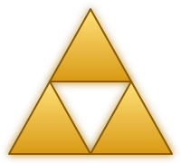

<!-- Save this as README.md in a repo named exactly "Yevan-0" (github.com/Yevan-0/Yevan-0) -->

<div align="center">




<a href="https://github.com/Yevan-0">
  
</a>

<br/>


<a href="https://www.linkedin.com/in/yevan-dewathanthriarachchi-512693247">
  
</a>
<a href="https://github.com/Yevan-0?tab=followers">
  
</a>

❤️ ❤️ ❤️ 🤍

</div>

---

## 🛡️ About Me

```ts
const yevan = {
  name: "Yevan Dewathanthriarachchi",
  location: "Sri Lanka 🇱🇰",
  role: "Developer",
  currentlyLearning: ["Advanced TypeScript", "System design", "Cool new frameworks"],
  funFact: "I debug with console.log and I'm not ashamed 😎",
  lookingFor: "Projects worth building and people worth building with",
};
```

- 🔭 Building web apps with **React** and **TypeScript**
- 🐍 Hacking on automation and tools with **Python**
- 🕸️ Poking around the web with scrapers and little experiments
- 🎮 Making small games for fun
- 🌱 Always learning, always shipping

---

## 🧚 Interests

<div align="center">


</div>

- 🎮 **Gaming** – exploring big worlds and building small ones
- 🎧 **Music** – always something playing while I code
- 🏅 **Sports** – **rowing** 🚣 and **badminton** 🏸
- 🎥 **Videography** and 📷 **photography** – capturing moments worth keeping

---

## 🎒 Tech Stack

<div align="center">


</div>

---

## 🗺️ Featured Projects

<table>
  <tr>
    <td width="50%" valign="top">
      <h3>🏰 <a href="https://github.com/Yevan-0/Portfolio">Portfolio</a></h3>
      <p>My personal corner of the internet, built with TypeScript.</p>
      
    </td>
    <td width="50%" valign="top">
      <h3>🏹 <a href="https://github.com/Yevan-0/target-hunter">target-hunter</a></h3>
      <p>A TypeScript project all about hunting down targets.</p>
      
    </td>
  </tr>
  <tr>
    <td width="50%" valign="top">
      <h3>🍖 <a href="https://github.com/Yevan-0/Recipe-Manager">Recipe-Manager</a></h3>
      <p>Keep your recipes organised, powered by Python.</p>
      
    </td>
    <td width="50%" valign="top">
      <h3>⛩️ <a href="https://github.com/Yevan-0/torii-game">torii-game</a></h3>
      <p>A JavaScript game project with a Japanese gate theme.</p>
      
    </td>
  </tr>
  <tr>
    <td width="50%" valign="top">
      <h3>🧭 <a href="https://github.com/Yevan-0/web-scraping">web-scraping</a></h3>
      <p>Experiments in pulling data off the web.</p>
      
    </td>
    <td width="50%" valign="top">
      <h3>📜 <a href="https://github.com/Yevan-0/react-assignments">react-assignments</a></h3>
      <p>My React learning journey, one assignment at a time.</p>
      
    </td>
  </tr>
</table>

---

## 📊 GitHub Stats

<div align="center">


</div>

---

## 📈 Contribution Graph

<div align="center">

<a href="https://github.com/Yevan-0">
  
</a>

</div>

---

## 🤝 Let's Connect

<div align="center">

<a href="https://www.linkedin.com/in/yevan-dewathanthriarachchi-512693247">
  
</a>
<a href="https://github.com/Yevan-0">
  
</a>
<a href="https://github.com/Yevan-0/Portfolio">
  
</a>

<br/><br/>

<i>"Make it work, make it right, make it fast."</i> ⚡


</div>
